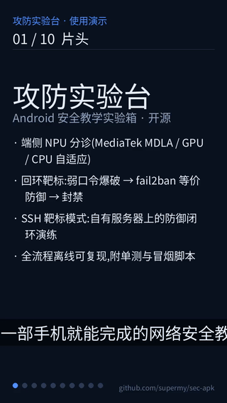

# 攻防实验台(sec-apk)——非 Root 本机网络攻防教学 APK

[](https://github.com/supermy/sec-apk/actions/workflows/build.yml)
[](LICENSE)

端侧决策:本地弱口令靶标 + 爆破模拟 + fail2ban 式封禁 + **Laya NPU 告警分诊**(天玑 9500 MDLA）。
全部流量仅限本机回环(127.0.0.1),用于学习与演示,不涉及外部目标。

---

## 演示视频(语音解说 + 字幕)

[](demo/seclab-demo.mp4)

- 完整版约 3.6 分钟,含语音解说与烧录字幕:[demo/seclab-demo.mp4](demo/seclab-demo.mp4)
- 字幕文件(可单独导入播放器):[demo/subtitles.srt](demo/subtitles.srt)
- 重新生成(改 `demo/script.json` 解说词后):`bash demo/make_demo.sh`(依赖 ffmpeg 与 `pip3 install edge-tts`)

---

## 1. 目录结构

```
~/sec-apk/
├── AndroidManifest.xml          # com.selfhost.layasec, minSdk31 / targetSdk28
├── build.sh                     # kotlinc + d8 + aapt2 + apksigner(ANDROID_JAR/KOTLINC/KS/JNIEXEC 可覆盖)
├── run-tests.sh                 # 纯逻辑单元测试(JVM 直跑,无需 Gradle/JUnit/设备)
├── smoke.sh                     # 真机冒烟:单测回归+APK 结构+素材环境+启动+人工清单(--install 顺带发安装)
├── test/                        # CoreLogicTest:IP 校验/告警解析/配置读写/配色/字典与停止(36 断言)
├── native/arm64-v8a/            # 预编译推理运行时 + runner(CI/离线构建用,构建时装入 jniLibs)
├── .github/workflows/build.yml  # GitHub Actions:单元测试 + 构建 APK + 上传产物
├── demo/                        # 演示视频管线:script.json 解说词 + make_slides.py + make_demo.sh(edge-tts+ffmpeg)
├── libs/jsch-2.28.8.jar         # 纯 Java SSH 客户端(仅用于目标机防护演习)
├── finetune/upload_sec2_myjev.py # sec2 模型包上传 ModelScope(PC 执行,与 laya-test 共用仓库)
├── tools/make_icon.py           # 应用图标生成(盾+剑+NPU 电路节点+来袭箭头,Pillow)
├── res/                         # 深色主题卡片/按钮 drawable + 自适应图标 + 联系人二维码
└── src/
    ├── com/laya/                # 复用 laya-test 推理引擎(7 个类,无 R/无 Android 业务依赖)
    │   ├── LayaJson.kt  LayaTokenizer.kt  LayaCalibration.kt
    │   ├── LayaPromptBuilder.kt  LayaDecoder.kt
    │   ├── DecisionEngine.kt  LayaRunnerEngine.kt
    └── com/selfhost/layasec/
        ├── SecTriage.kt         # NPU 分诊:读 /sdcard/models/laya-litert-sec/phone,三问决策 + 分诊示例数据
        ├── SecLab.java          # 靶标 HTTP 服务 + 爆破模拟 + 防御方(事件流含 $ 实际命令)
        ├── SshOps.java          # SSH 目标机防护演习(自有设备:检查/部署 fail2ban/告警分诊/封禁解封)
        ├── ModelNet.java        # ModelScope 网络拉取端侧模型(sec2/phone,跳过完整文件 + 断点续传)
        ├── Theme.java           # 深色主题配色 + 富文本小工具(v0.5 重构抽出)
        ├── EventFeed.java       # 事件流:记录时定格时间戳 + 类型着色 + 目标机标注 + 贴底滚动
        ├── TargetStore.java     # 演练目标机配置读写(/sdcard/sec-lab/ssh-target.json,可注入路径)
        └── MainActivity.java    # 深色控制台 UI(⋮菜单说明/联系人、步骤门控、SSH 靶标模式、事件流)
```

引擎链:`NPU(MTK MDLA dispatch,独立进程 runner)→ GPU(wfp16)→ CPU`,sec 包通常只带 NPU 主图,故 MTK 机型走 NPU。

---

## 2. 构建与安装(Termux + adb 无线)

```bash
# 构建(产出 ~/sec-apk/seclab-<HHMM>.apk,约 5.9MB;SSH 依赖 libs/jsch-*.jar)
cd ~/sec-apk && bash build.sh
# 无 adb 时的直装:cp seclab-<HHMM>.apk /sdcard/Download/ 然后用文件管理器点开安装

# 纯逻辑单元测试(JVM 直跑,无需 Gradle/JUnit/设备;32 断言)
bash run-tests.sh

# 真机冒烟(自动 21 项 + 人工清单;--install 顺带发起安装)
bash smoke.sh [--install]

# 连接本机无线调试(端口每次会变,用现成脚本自动扫)
bash ~/adbre.sh                 # 输出形如 127.0.0.1:<port> device

# 安装(注意:必须 --no-incremental,HyperOS 下增量安装会 INSTALL_FAILED_USER_RESTRICTED)
adb -s 127.0.0.1:<port> install -r --no-incremental seclab-<HHMM>.apk

# 授予存储权限(读 /sdcard/models)
adb -s 127.0.0.1:<port> shell appops set com.selfhost.layasec MANAGE_EXTERNAL_STORAGE allow
adb -s 127.0.0.1:<port> shell pm grant com.selfhost.layasec android.permission.READ_EXTERNAL_STORAGE

# 启动
adb -s 127.0.0.1:<port> shell am start -n com.selfhost.layasec/.MainActivity
```

---

## 3. 使用流程(应用内)

界面深色主题,**Tab 分页**:「演练」(状态卡 + 步骤按钮)/「分诊」(手动分诊,按钮竖排)/「SSH目标」(①~⑥ 步骤门控,上一步成功才解锁下一步);
**事件流固定常驻屏幕下半区,单屏可见**。标题栏右上 **⋮ 菜单**:使用说明 / 联系人二维码。
**首次启动自动弹出使用说明**(含使用警告与法律责任、仅供学习、Apache-2.0 商用署名说明)。

步骤按钮带先后序号与状态:未做=序号灰底,完成=**✓ 变绿**,执行中=「…处理中」禁用。
事件流中 **青色 `$` 行 = 该步骤实际执行/等效的命令**(靶标 `curl` 探活、爆破 `curl` 循环、封禁 `iptables` 等效、SSH 远端脚本全文)。

| 步骤 | 按钮 | 作用 | 预期结果 |
|---|---|---|---|
| ① | **网络拉取模型**(可选) | 从 ModelScope 公共仓库 `supermy/myjev → sec2/phone` 下载端侧模型;MTK 取 NPU 主图、其它机型取 GPU(wfp16),已完整文件自动跳过,支持断点续传 | 事件流逐文件「下载/跳过」,结束时汇总 |
| ② | **安装模型**(可选) | 从 `/sdcard/models/laya-litert-sec/phone` 拷模型到应用私有目录(约 650MB);不装则直接用源包 | 事件流出现「模型安装完成」 |
| ③ | **加载引擎(NPU)** | 启动 `libnpu_rt.so` 独立进程,加载 251MB NPU 主图 + scorer | 状态卡引擎变 `NPU(MTK MDLA)` |
| ④ | **启动靶标** | 回环 `127.0.0.1:18080` 起弱口令登录服务(testuser/test123) | 事件流提示靶标地址 + `curl` 探活命令 |
| ⑤ | **模拟爆破** | 34 条弱口令字典并发尝试,仅指向本机靶标 | 每条 `POST /login password="…" → 401/403` |
| ⑥ | **启动防御** | 窗口 10s 内失败 ≥5 次即封禁,并触发 NPU 分诊 | `★ 封禁 127.0.0.1` + `分诊[NPU]: …` |
| — | **一键演示** | ④⑤⑥ 顺序自动执行 | 见下方实测输出 |
| — | **停止全部 / 清空封禁** | 复位 | 状态卡恢复 |

> 说明:因为靶标与攻击方同源(回环),封禁后所有后续请求都会 `403 已被封禁`——这正是 fail2ban 生效的直观演示。
> **手动分诊**:点「示例」载入一条安全文本(5 类别 + 2 条困难负例,可再编辑),点「分诊」→ 输出类别/严重度/是否需人工研判 + 建议动作。

### 3.1 SSH 目标机防护演习(仅限自有/已授权设备)

**演练目标机可设定**:填好 主机/端口/用户 后点「设为演练目标机」,即保存到 `/sdcard/sec-lab/ssh-target.json`
(App 启动自动载入,可外部编辑改目标;①连接测试成功后也会自动设定);密码不落盘。
状态卡第 4 行常显「SSH目标机 user@host:port · 远端封禁以④输出为准」,与「本机靶标/本机封禁」两套目标明确区分。

用于把「告警 → NPU 分诊 → 处置」闭环搬到真实服务器上演练(本机爆破模拟仍只打回环,不指向目标机):

| 按钮 | 作用 | 说明 |
|---|---|---|
| **连接测试** | `uname` / `hostname` / `whoami` | 验证 SSH 连通;密码不落盘(仅内存) |
| **防护检查** | sshd 关键配置(Port/登录策略/MaxAuthTries)+ 近期失败登录计数 + fail2ban 状态 | 只读 |
| **部署实验规则** | 写入 `/etc/fail2ban/jail.d/sshd-lab.local`(5 次失败/600s 封 600s)并重启 fail2ban | 需 root 或免密 sudo,弹窗确认后执行 |
| **拉取告警并分诊** | 从 journalctl/auth.log 抓失败登录,TOP 来源 IP + 样例日志送入端侧模型 | 输出 `SSH 分诊[NPU]: 类别/严重度/研判/建议` |
| **封禁源IP / 解封源IP** | `fail2ban-client set sshd banip/unbanip` | 默认填入上一步解析出的 TOP IP |

典型演习:目标机开 sshd → 用另一台设备(或口令喷洒工具,限自有)尝试弱口令 → App 拉取告警并分诊 → 一键封禁 → 复测被拒 → 解封恢复。

日志留痕:`/sdcard/Android/data/com.selfhost.layasec/files/{access.log,defense.log}`。

---

## 4. 实测结果(Redmi / HyperOS, MT6993 天玑9500, 非 Root)

一键演示后事件流节选:

```
[10:51:15] 靶标已启动 http://127.0.0.1:18080/login(弱口令 testuser/test123,仅本机)
[10:51:15] 防御方已启动:窗口 10s 内失败 ≥ 5 次即封禁
[10:51:15] 开始模拟弱口令爆破(34 个候选,并发 4)
[10:51:15] 失败登录 #1 … #4 ip=127.0.0.1 user=testuser
[10:51:15] ★ 封禁 127.0.0.1(5 次失败登录/10s)
[10:51:15] dragon → 403 已被封禁   (后续 29 条全部 403)
[10:51:15] 爆破结束: 命中 0, 被拦截 29/34
[10:51:15] 分诊[NPU]: 类别=侦察探测(0.90) 严重度=2.00/5(一般) 人工研判=0.88 → 封禁IP并转人工研判 [NPU(MTK MDLA) 310ms]
```

**结果解读**:
- **封禁生效**:5 次失败即封,后续请求 403,命中 0 —— 防御方成功阻断爆破。
- **NPU 分诊**:端侧决策模型判定为「侦察探测」(置信 0.90)、严重度 2.00、人工研判概率 0.88 → 建议「封禁 IP 并转人工研判」;单次三问推理 **310ms**(含首次 runner 冷启),热路径为 54–59ms/问。
- 状态卡该时刻:模型就绪 · 引擎 `NPU(MTK MDLA)` · 靶标运行中 :18080 · 防御运行中(窗口10s/阈值5) · 封禁 `127.0.0.1`。

---

## 5. sec 决策模型微调(GPU 机 192.168.0.168)

底座 `convaiinnovations/laya-multilingual`(mmBERT,322M),任务定义 `task_sec.json`
(类别 choice / 严重度 score / 是否人工研判 noul)。训练在 RTX 5060 Ti(torch 2.12+cu130)。

一次性配置 SSH(密码用环境变量,勿写入文件):

```bash
export SSHPASS='<你的密码>'
COMMON="-o StrictHostKeyChecking=accept-new -o UserKnownHostsFile=~/.ssh/kv_sec"
H="sshpass -e ssh $COMMON my@192.168.0.168"
```

### 5.1 基线评估(现有 laya-sec-ft)

```bash
$H 'cd /data/ai/finetune && USE_TF=0 HF_HUB_OFFLINE=1 venv/bin/python evaluate.py \
  --model /data/ai/laya-sec-ft --data data/sec-test.jsonl --classes data/sec-classes.json --task sec'
```

结果:

| 指标 | 值 | 说明 |
|---|---|---|
| choice 准确率 / macro-F1 | **0.9984 / 0.9988** | 类别判别极强(测试集同分布,偏乐观) |
| **score MAE / within-1** | **1.017 / 0.60** | **短板:严重度回归差** |
| noul F1 / ECE | 0.969 / 0.0635 | 可用 |

### 5.2 数据增强(v2,针对 score 短板)

新增 `collect_sec2.py`(CISA KEV 已知被利用漏洞)+ `convert_sec2.py`:

- 真实源细化严重度:NVD **CVSS 连续分 → 1-5 五档**(v1 只有三档)
- 新增 **CISA KEV**(在野利用 → 严重度5 / 必须研判)
- 合成严重度分级:模板内嵌「高危/紧急/低危/例行」提示词
- 正常业务加入**困难负例**(例行扫描无风险、误报调优),压「侦察/正常」边界
- 类别配额封顶,5 类各 6000,避免攻击语料压垮其它类

```bash
$H 'cd /data/ai/finetune && venv/bin/python collect_sec2.py && venv/bin/python convert_sec2.py'
```

结果:`30,000` 条(5×6000),严重度分布 1–5 齐全;`sec2-train.jsonl 28,200 / sec2-test.jsonl 1,800`。

### 5.3 训练

```bash
# 先停 LLM 后端释放显存(记下启动命令)
$H 'cat /data/ai/restart-llama.sh'         # 训练完用它原样重启 8899
$H 'pkill -f "llama-server.*8899"'
# 后台训练(~5h;日志 /data/ai/logs-cancer/train-sec2.log)
$H 'cd /data/ai && setsid nohup /data/ai/finetune/train_sec2.sh > /data/ai/logs-cancer/train-sec2.log 2>&1 < /dev/null &'
# 观察
$H 'tail -f /data/ai/logs-cancer/train-sec2.log; nvidia-smi --query-gpu=memory.used,utilization.gpu --format=csv'
```

训练启动实测:`训练 items: 84600(每行 3 问)  train=84200 calib=400`,显存 6.6GB / GPU 96%,reward 由 -0.16 升至 ~0.44。
完成后重启 LLM 后端:`$H 'bash /data/ai/restart-llama.sh'`。

### 5.4 评估 v2 并对比基线

```bash
$H 'cd /data/ai/finetune && venv/bin/python evaluate.py \
  --model /data/ai/laya-sec-ft2 --data data/sec2-test.jsonl --classes data/sec2-classes.json --task sec'
```
重点看 **score MAE 是否从 1.017 下降**(数据增强的主要目标)。

### 5.5 导出 + 端侧 NPU 部署

```bash
# ① 导出 int8 ONNX(端侧 ORT 兼容)
$H 'cd /data/ai/finetune && venv/bin/python export_onnx.py --ckpt /data/ai/laya-sec-ft2 ... '
# ② LiteRT GPU/NPU 转换链(conv → fp16 → split_negfix → AOT MT6993)
$H 'cd /data/ai && bash /data/ai/finetune/chain_litert.sh sec'
# ③ 拷回手机并替换
adb push <新的 phone/ 文件> /sdcard/models/laya-litert-sec/phone/
```

替换后重开 APK → **加载引擎(NPU)** → **一键演示**,观察新模型的分诊类别/严重度。

### 5.6 一键后处理(训练→评估→导出→NPU 打包)

`finetune/post_train_sec2.sh` 在 GPU 机上常驻等待,训练一结束便自动串起后续全部步骤并留痕:

```bash
# 上传脚本并后台守候(训练结束自动执行)
scp finetune/{post_train_sec2.sh,mkphone_sec.py} my@192.168.0.168:/data/ai/finetune/
$H 'setsid bash /data/ai/finetune/post_train_sec2.sh >/dev/null 2>&1 </dev/null & disown'
# 跟踪进度
$H 'tail -f /data/ai/logs-cancer/post-sec2.log'
```

流程:`等待训练结束` → `重启 llama-server(8899)` → `evaluate.py → metrics-sec2.json`
→ `export_onnx.py → /data/ai/laya-sec2-int8` → `chain_litert.sh sec2`(aet_convert→fp16→split_negfix→AOT MT6993)
→ `mkphone_sec.py sec2 → /data/ai/phone-sec2`。末尾输出 `SEC2-POST-ALL-DONE`。

产出的 `phone-sec2/` 是端侧可直接替换的模型包(`laya_ml_s256_embeds_npu.tflite` + `laya_ml_scorer.bin` + 词表 + 校准 + `questions.json` + `label.txt`)。
换到手机:`adb push phone-sec2/. /sdcard/models/laya-litert-sec/phone/`,重开 APK → 加载引擎(NPU) → 一键演示。

---

## 6. 注意事项

- 靶场与攻击方**仅指向本机回环**,用于教学;请勿改指向外部目标。
- SSH 防护演习**仅限自有或已授权设备**:只做只读检查与 fail2ban 防御配置,不含任何攻击动作;密码仅内存使用不落盘。
- HyperOS 安装需 `--no-incremental`;首次安装若弹确认框,需在设备上点允许。
- sec 模型包**只带 NPU 主图**(`laya_ml_s256_embeds_npu.tflite`),非 MTK 机型无 GPU 兜底主图。
- 微调数据集含合成文本(冷启动),分布 ≠ 真实安全运营数据;上线前建议换真实告警语料。
- 训练期间 8899 LLM 通道不可用,训练结束用 `/data/ai/restart-llama.sh` 恢复。